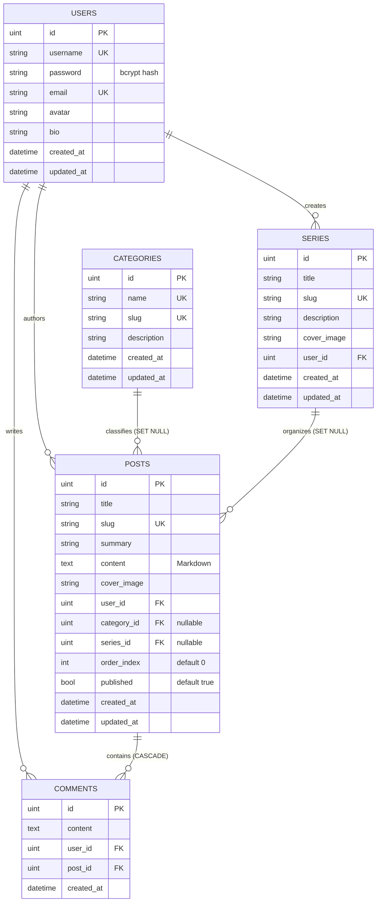

# 🌐 Cyber-Blog Engine

[](https://pkg.go.dev/github.com/tonsiasy/cyber-blog)
[](https://goreportcard.com/report/github.com/tonsiasy/cyber-blog)
[](LICENSE)

**Cyber-Blog** 是一个面向 Web3 开发者与极客独立博主的现代化内容发布平台后端引擎。基于 **Go 1.27**、**Gin**、**GORM**、**PostgreSQL 18** 与 **Cloudflare R2** 构建，融合云原生架构规范与极客美学设计。

本项目同时完整对齐 **Gin 课程第五阶段综合大作业** 要求，并通过 `/api/v1` 与 `/api` 双轨路由设计提供 **100% 课程向前兼容性**。

---

## ⚡ 核心特性 (Features)

- 🔐 **现代用户认证与授权 (M2)**: 采用 `golang-jwt/jwt/v5` 签名标准与 `golang.org/x/crypto/bcrypt` 强哈希（Cost 10），支持 Bearer Token 鉴权中间件与当前用户信息直查（`/me`）。
- 📝 **文章全生命周期管理 (M3)**: 具备防碰撞 SEO 友好 Slug 自动生成、分页检索（上限 50 条软性保护）、发布状态过滤、作者独占修改与删除鉴权。
- 💬 **评论互动与级联完整性 (M4)**: 读者评论发表、按时间正序流式检索，配备数据库级外键级联清理（删文自动同步级联清理所有关联评论）。
- 📚 **多维分类与专栏编排 (M5)**:
  - **Category (主题分类)**: 独立 Slug 路由，列表响应内置文章计数聚合（`post_count`）。
  - **Series (系列专栏)**: 支持文章关联系列，专栏大纲接口按照 `order_index ASC` 章节严格保序输出。
- ☁️ **Cloudflare R2 对象存储集成 (M6)**:
  - 接入 AWS SDK Go v2，完全兼容 S3 协议，享受 Cloudflare **0 流量出站费 (Zero Egress Fees)**。
  - **双模存储架构 (`StorageService`)**: 生产自动对接 R2 存储桶；离线开发或凭证缺省时无感降级为本地磁盘存储（`./uploads`），零外部网络依赖。
  - **直传与预签名双支持**: 既支持服务端流式接收多媒体，也支持生成 15 分钟临时预签名 PUT URL 供前端直传。
- 🛡️ **工程规范与健壮设计 (M7)**:
  - 遵循 12-Factor 规范的轻量环境变量配置管理（`godotenv`）。
  - 自动化数据库表迁移与严格的外键约束（`AutoMigrate` + `PRAGMA foreign_keys = ON`）。
  - 100% 覆盖关键业务流的集成单元测试套件（SQLite 自动化隔离测试）。

---

## 📐 架构设计 (Architecture)

### 1. 系统分层流转

```
                      +---------------------------------------+
                      |       Client / HTTP Requests          |
                      +---------------------------------------+
                                          |
                                          v
+---------------------------------------------------------------------------------+
| Gin HTTP Engine (r)                                                             |
|                                                                                 |
|   +------------------------+  /api/v1/posts, /me  +-------------------------+   |
|   | Global Logger/Recovery | -------------------> | AuthRequired Middleware |   |
|   +------------------------+                      +-------------------------+   |
|               |                                                |                |
|               v                                                v                |
|   +-------------------------------------------------------------------------+   |
|   | Handlers Layer: Auth | Post | Comment | Taxonomy | Media                |   |
|   +-------------------------------------------------------------------------+   |
|               |                                                |                |
|               v                                                v                |
|   +-------------------------+                     +-------------------------+   |
|   | Models / GORM Layer     |                     | Storage Service Engine  |   |
|   | (Post, User, Series...) |                     | (R2Storage / Local)     |   |
|   +-------------------------+                     +-------------------------+   |
+---------------------------------------------------------------------------------+
                |                                                |
                v                                                v
    +-----------------------+                        +-----------------------+
    | PostgreSQL 18.4 /     |                        | Cloudflare R2 /       |
    | SQLite Database       |                        | Local Disk Storage    |
    +-----------------------+                        +-----------------------+
```

### 2. 数据库实体关系 (Entity-Relationship)



---

## 🚀 快速上手 (Quick Start)

### 1. 环境准备
- 安装 **Go 1.27+**
- (可选) 安装 **PostgreSQL 18** 或直接使用内置 **SQLite**

### 2. 获取代码与安装依赖
```bash
git clone https://github.com/tonsiasy/cyber-blog.git
cd cyber-blog
go mod download
```

### 3. 配置环境变量 (`.env`)
复制示例配置并按需修改：
```bash
cp .env.example .env
```

| 环境变量配置项 | 说明 | 默认值 (本地测试) |
| :--- | :--- | :--- |
| `PORT` | HTTP 监听端口 | `8080` |
| `GIN_MODE` | Gin 运行模式 (`debug` / `release`) | `debug` |
| `DB_DRIVER` | 数据库驱动 (`sqlite` 或 `postgres`) | `sqlite` |
| `DB_SQLITE_PATH` | 本地 SQLite 文件名 | `cyber_blog.db` |
| `DB_HOST` | PostgreSQL 主机地址 | `localhost` |
| `DB_PORT` | PostgreSQL 端口 | `5432` |
| `DB_USER` | PostgreSQL 用户名 | `blog_user` |
| `DB_PASSWORD` | PostgreSQL 密码 | `your_secure_password` |
| `DB_NAME` | PostgreSQL 数据库名 | `cyber_blog` |
| `JWT_SECRET` | JWT 签名密钥 | `cyber-blog-default-secret-key-2026` |
| `JWT_EXPIRATION_HOURS` | Token 有效时长 (小时) | `72` |
| `R2_ACCOUNT_ID` | Cloudflare R2 Account ID | *(留空时自动降级为本地存储)* |
| `R2_ACCESS_KEY_ID` | Cloudflare R2 API Token Access Key | *(同上)* |
| `R2_SECRET_ACCESS_KEY` | Cloudflare R2 API Token Secret Key | *(同上)* |
| `R2_BUCKET_NAME` | Cloudflare R2 存储桶名 | *(同上)* |
| `R2_PUBLIC_DOMAIN` | R2 公网访问域名 (如 `https://media.yoursite.com`) | `""` |

### 4. 启动服务
```bash
go run main.go
```
服务成功启动后将输出：
```text
[Database] 正在连接 SQLite (cyber_blog.db)...
[Database] 数据模型迁移完成，表与索引已就绪！
[Main] Cyber-Blog 后端服务启动，正在监听端口 :8080 ...
```

---

## 🧪 自动化测试 (Testing)

项目采用自动化隔离测试，所有测试用例均自带内存/临时 SQLite 库，测试完毕自动清理：

```bash
# 运行全项目单元与集成测试
go test -v ./...

# 仅测试存储模块
go test -v ./pkg/storage/...

# 仅测试业务 Handlers 流程
go test -v ./handlers/...
```

---

## 📡 完整 API 路由规范 (API Reference)

系统提供带有版本号的生产路由 `/api/v1/*`，同时保留作业无版本前缀路由 `/api/*`：

### 1. 认证路由 (`/api/v1/auth`)
- `POST /api/v1/auth/register` - 用户注册
- `POST /api/v1/auth/login` - 用户登录（返回 JWT Token）
- `GET  /api/v1/auth/me` - 获取当前登录用户信息 *(需 Bearer Token)*

### 2. 文章管理 (`/api/v1/posts`)
- `GET    /api/v1/posts` - 文章列表（分页：`?page=1&pageSize=10`，最大 50）
- `GET    /api/v1/posts/:id` - 获取文章详情
- `POST   /api/v1/posts` - 发布新文章 *(需登录)*
- `PUT    /api/v1/posts/:id` - 修改文章 *(仅限作者本人)*
- `DELETE /api/v1/posts/:id` - 删除文章 *(仅限作者本人，级联删除评论)*

### 3. 评论互动 (`/api/v1/posts/:id/comments`)
- `GET  /api/v1/posts/:id/comments` - 获取文章所有评论（按发表时间正序排列）
- `POST /api/v1/posts/:id/comments` - 发表文章评论 *(需登录)*

### 4. 主题与系列专栏 (`/api/v1/categories`, `/api/v1/series`)
- `GET  /api/v1/categories` - 获取分类列表及其文章聚合数 (`post_count`)
- `GET  /api/v1/categories/:slug/posts` - 获取特定分类下的所有文章
- `POST /api/v1/categories` - 创建新分类 *(需登录)*
- `GET  /api/v1/series` - 获取专栏列表
- `GET  /api/v1/series/:slug` - 获取专栏大纲（章节严格按 `order_index ASC` 排序）
- `POST /api/v1/series` - 创建专栏 *(需登录)*

### 5. 多媒体存储 (`/api/v1/media`)
- `POST /api/v1/media/upload` - 服务端流式上传图片至 R2 / 本地 *(需登录，限制 10MB)*
- `POST /api/v1/media/presign` - 获取客户端直传预签名 PUT URL *(需登录)*

> 💡 **提示**: 完整可执行的接口请求样例可直接查阅根目录下的 [`api_test.http`](./api_test.http)，支持在 VS Code (REST Client) 或 GoLand / IntelliJ 中一键点击测试。

---

## 🚢 生产环境部署 (Production Deployment)

### 1. 远程 PostgreSQL 18 连接 (阿里云 ECS)
若使用远端宿主机容器内 PostgreSQL，可配置 SSH 隧道端口转发在本地直接联调远端真实库：
```bash
ssh -L 5432:localhost:5432 ali
```
随后在 `.env` 中设置：
```env
DB_DRIVER=postgres
DB_HOST=127.0.0.1
DB_PORT=5432
DB_USER=blog_user
DB_PASSWORD=your_secure_password
DB_NAME=cyber_blog
```

### 2. Cloudflare Tunnel 反向代理暴露
利用现有 `cloudflared` 隧道守护进程，添加 Ingress 映射规则：
```yaml
ingress:
  - hostname: blog-api.yourdomain.com
    service: http://localhost:8080
  - service: http_status:404
```

---

## 📄 开源许可 (License)

本项目采用 [MIT License](LICENSE) 授权开源。
