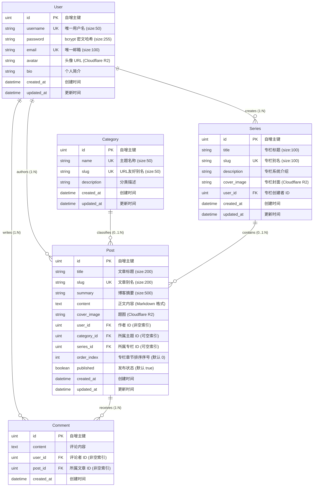

# Cyber-Blog 数据库实体关系建模与数据架构文档

本文档为 `cyber-blog` 核心数据持久层架构的官方权威参考，规范了数据实体、关联关系、外键策略与索引设计。

---

## 1. 实体关系图 (Entity-Relationship Diagram)

---

## 2. 数据字典 (Data Dictionary)

### 2.1 用户表 (`users`)
| 字段名 | 类型 | 约束 | 说明 |
|---|---|---|---|
| `id` | `BIGSERIAL` / `INT AUTO_INCREMENT` | PRIMARY KEY | 全局唯一自增主键 |
| `username` | `VARCHAR(50)` | UNIQUE, NOT NULL | 登录凭据与公开显示标识 |
| `password` | `VARCHAR(255)` | NOT NULL | bcrypt 哈希密文，JSON 序列化过滤 |
| `email` | `VARCHAR(100)` | UNIQUE, NOT NULL | 邮箱地址，用于通知与找回 |
| `avatar` | `VARCHAR(255)` | NULLABLE | 用户头像，托管于 Cloudflare R2 |
| `bio` | `VARCHAR(255)` | NULLABLE | 个人签名 / 个人简介 |
| `created_at` | `TIMESTAMPTZ` | NOT NULL | 注册时间戳 |
| `updated_at` | `TIMESTAMPTZ` | NOT NULL | 资料最后修改时间戳 |

### 2.2 主题分类表 (`categories`)
| 字段名 | 类型 | 约束 | 说明 |
|---|---|---|---|
| `id` | `BIGSERIAL` / `INT AUTO_INCREMENT` | PRIMARY KEY | 主题自增主键 |
| `name` | `VARCHAR(50)` | UNIQUE, NOT NULL | 显示名称（如 "Web3", "Go后端"） |
| `slug` | `VARCHAR(50)` | UNIQUE, NOT NULL | URL 路由标识（如 `/category/web3`） |
| `description` | `VARCHAR(255)` | NULLABLE | 分类功能与涵盖领域说明 |
| `created_at` | `TIMESTAMPTZ` | NOT NULL | 创建时间 |
| `updated_at` | `TIMESTAMPTZ` | NOT NULL | 修改时间 |

### 2.3 系列专栏表 (`series`)
| 字段名 | 类型 | 约束 | 说明 |
|---|---|---|---|
| `id` | `BIGSERIAL` / `INT AUTO_INCREMENT` | PRIMARY KEY | 专栏自增主键 |
| `title` | `VARCHAR(100)` | NOT NULL | 专栏名称（如《深入浅出以太坊底层》） |
| `slug` | `VARCHAR(100)` | UNIQUE, NOT NULL | 专栏路由别名 |
| `description` | `TEXT` | NULLABLE | 专栏大纲与读者预期收益介绍 |
| `cover_image` | `VARCHAR(255)` | NULLABLE | 专栏横幅或大图（R2） |
| `user_id` | `BIGINT` | FOREIGN KEY, NOT NULL | 专栏创建者（引用 `users.id`） |
| `created_at` | `TIMESTAMPTZ` | NOT NULL | 创建时间 |
| `updated_at` | `TIMESTAMPTZ` | NOT NULL | 修改时间 |

### 2.4 文章表 (`posts`)
| 字段名 | 类型 | 约束 | 说明 |
|---|---|---|---|
| `id` | `BIGSERIAL` / `INT AUTO_INCREMENT` | PRIMARY KEY | 文章自增主键 |
| `title` | `VARCHAR(200)` | NOT NULL | 博客标题 |
| `slug` | `VARCHAR(200)` | UNIQUE, NULLABLE | 友好 URL，利于 SEO 和阅读 |
| `summary` | `VARCHAR(500)` | NULLABLE | 列表页预览摘要 |
| `content` | `TEXT` | NOT NULL | Markdown / MDX 格式正文 |
| `cover_image` | `VARCHAR(255)` | NULLABLE | 文章头图（R2） |
| `user_id` | `BIGINT` | FOREIGN KEY, NOT NULL | 文章作者（引用 `users.id`） |
| `category_id` | `BIGINT` | FOREIGN KEY, NULLABLE | 主题归属（引用 `categories.id`） |
| `series_id` | `BIGINT` | FOREIGN KEY, NULLABLE | 专栏归属（引用 `series.id`） |
| `order_index` | `INT` | DEFAULT 0 | 专栏章节排序序号（数字越小越靠前） |
| `published` | `BOOLEAN` | DEFAULT TRUE | 状态：`false` 草稿，`true` 发布 |
| `created_at` | `TIMESTAMPTZ` | NOT NULL | 发布时间 |
| `updated_at` | `TIMESTAMPTZ` | NOT NULL | 最后编辑时间 |

### 2.5 评论表 (`comments`)
| 字段名 | 类型 | 约束 | 说明 |
|---|---|---|---|
| `id` | `BIGSERIAL` / `INT AUTO_INCREMENT` | PRIMARY KEY | 评论自增主键 |
| `content` | `TEXT` | NOT NULL | 读者留言内容 |
| `user_id` | `BIGINT` | FOREIGN KEY, NOT NULL | 留言用户（引用 `users.id`） |
| `post_id` | `BIGINT` | FOREIGN KEY, NOT NULL | 被评论文章（引用 `posts.id`） |
| `created_at` | `TIMESTAMPTZ` | NOT NULL | 评论发表时间 |

---

## 3. 索引与级联约束策略

### 3.1 索引设计
1. **唯一性索引 (Unique Indexes)**：
   - `users(username)`、`users(email)`：保障账号全球唯一。
   - `categories(slug)`、`series(slug)`：保障分类与专栏路由唯一。
   - `posts(slug)`：文章友好别名唯一。采用 GORM 钩子自动兜底机制（见 3.3）。
2. **关联与复合索引 (Compound & Foreign Key Indexes)**：
   - `posts(user_id)`：加速用户个人作品列表查询。
   - `posts(category_id)`：加速分类文章聚合。
   - `posts(series_id, order_index)`：**核心复合索引**，专栏章节列表查询的核心加速点，保证专栏目录秒级渲染。
   - `comments(post_id, created_at)`：**核心复合索引**，文章详情页下拉取评论时的时间正序极速扫描。

### 3.2 外键级联约束规则 (Cascade Rules)
为避免误删以及保证数据引用完整性，显式定义以下 GORM 级联规则：
- **`Post` 关联 `Category` (`category_id`)**：`OnDelete:SET NULL`
  - *语义*：删除主题分类时，归属于该分类的文章**不得被删除**，而是将文章的 `category_id` 自动置为 `NULL`。
- **`Post` 关联 `Series` (`series_id`)**：`OnDelete:SET NULL`
  - *语义*：删除专栏时，专栏下的文章作为独立知识资产**予以保留**，仅将文章的 `series_id` 自动置为 `NULL`。
- **`Comment` 关联 `Post` (`post_id`)**：`OnDelete:CASCADE`
  - *语义*：文章被作者彻底物理删除时，附属于该文章的所有评论**自动级联清除**。
- **`Post` / `Series` 关联 `User` (`user_id`)**：`OnDelete:CASCADE` 或禁止物理删除用户
  - *语义*：账号销毁时级联清理，或在业务层仅允许逻辑冻结。

### 3.3 Slug 自动生成与冲突防范策略 (Slug Collision Avoidance)
由于作业基线与简易 API 仅要求传递 `title` 与 `content`：
- 若前端/调用方未显式传入 `slug`：
  - GORM `BeforeCreate` Hook 自动检测：若 `slug == ""`，则通过拼音/英文清洗 `title`，并追加短随机串或时间戳哈希（例如 `my-first-post-7a9f`），确保绝对不写入空字符串。
- 该机制彻底避免了多篇无 slug 文章在数据库 `UNIQUE` 索引上触发键值冲突。

### 3.4 软删除策略讨论
- 当前基线采用物理删除配合级联约束。未来若需审计与防误删，可在 `Post` 与 `Comment` 上无缝引入 `gorm.DeletedAt`。
