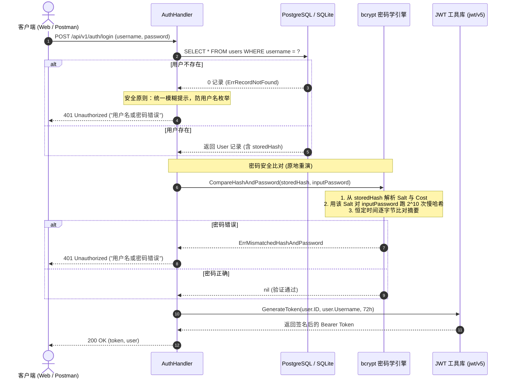

# Bcrypt 密码安全存储与单向哈希原理 (学习笔记)

> **背景**：Gin 博客系统综合项目（Homework 4 & Cyber-Blog）进阶复盘，深度整理密码学安全存储标准、慢哈希机制与计时攻击防范。  
> **时间**：2026-10  
> **关联源码**：[`05_Practical_Training/blog/pkg/utils/password.go`](file:///Users/wangtong/workspace/web3-lab/05_Practical_Training/blog/pkg/utils/password.go) & [`handlers/auth.go`](file:///Users/wangtong/workspace/web3-lab/05_Practical_Training/blog/handlers/auth.go)

---

## 1. 密码存储演变史：为什么 MD5 / SHA-256 全军覆没？

```
第1代：明文存储        ❌ 数据库一旦泄露（拖库），用户密码全部裸奔
       ⬇
第2代：普通哈希(MD5)    ❌ 彩虹表字典秒级反查（固定明文对应固定哈希）
       ⬇
第3代：简单加盐哈希    ❌ 挡不住现代 GPU 算力暴力破解（MD5/SHA 速度太快，单卡每秒算百亿次）
       ⬇
第4代：慢哈希(bcrypt)   ✅ 自带随机 Salt + 指数级计算轮次（故意变慢），让暴力破解算力成本呈天文数字
```

### 1.1 致命缺陷一：彩虹表反查 (Rainbow Table)
普通哈希是纯确定性的（输入相同，输出绝对相同）：
```text
md5("123456") = e10adc3949ba59abbe56e057f20f883e
```
攻击者事先计算好数十亿个常见密码的哈希字典（彩虹表）。拿到被窃取的数据库哈希后，直接反查字典，1 毫秒内就能拿到真实明文密码。

### 1.2 致命缺陷二：现代 GPU 的暴力破解速度太快
加盐（Salt）虽然破坏了通用彩虹表，**但解决不了计算速度过快的问题**：
* MD5 与 SHA-256 最初是为**文件完整性校验**设计的，目标是“计算越快越好”。
* 但在密码存储领域，“速度太快”等同于“给攻击者暴力破解行方便”。在一张消费级显卡（如 RTX 4090）上，GPU 每秒可以尝试 **数百亿次** SHA-256 计算，即使加盐也难逃暴力穷举。

---

## 2. Bcrypt 慢哈希的降维打击机制

`bcrypt` 是专门为**密码存储**而发明的一种自适应慢哈希算法（Slow Hash Algorithm）。

### 2.1 特性一：内置动态随机 Salt
每次调用 `bcrypt.GenerateFromPassword` 时，算法内部会自动生成一个 **128 位的独一无二的随机 Salt**。
* **显著特征**：哪怕同一个用户用完全相同的密码 `"MySecret123"` 连续加密 3 次，输出的密文字符串也截然不同！通用彩虹表彻底失效。

### 2.2 特性二：可调工作因子（Cost / Work Factor）
`bcrypt` 的计算复杂度由 `Cost` 决定，复杂度为 **$2^{\text{cost}}$ 轮** 密钥扩展循环。
* 项目中采用 `bcrypt.DefaultCost = 10`，意味着执行 $2^{10} = 1024$ 轮密集加密迭代。
* **对正常用户完全无感**：用户登录时 CPU 耗时约 50ms~80ms，人脑毫无卡顿感知。
* **对黑客是降维打击**：暴力破解速度从一秒上百亿次骤降到一秒十几次，暴力猜解一个 8 位复杂密码需要几百年。

---

## 3. 剖析 Bcrypt 密文字符串的内部结构

在数据库 `users` 表中存入的 60 字节密码字符串，采用了**自包含（Self-contained）**的优雅设计：

```text
$2a$10$vI8aWBnW3fID.ZQ4/zo1G.q1lRps.9cGLcZEiGDMVr5yUP1KUOYTa
├───┼──┼──────────────────────┼─────────────────────────────┤
 版本 Cost    22字符随机 Salt             31字符密码密文
```

| 字段片段 | 字符示例 | 含义解释 |
| :--- | :--- | :--- |
| **算法版本** | `$2a$` | 表示采用 bcrypt 规范的 2a 版本 |
| **计算轮次** | `$10$` | 表示工作因子 Cost 为 10（即计算 $2^{10} = 1024$ 轮） |
| **内嵌 Salt** | `vI8aWBnW3fID.ZQ4/zo1G.` | 生成时随机创建的 128 位 Salt（Base64 编码为 22 字符） |
| **哈希摘要** | `q1lRps.9cGLcZEiGDMVr5yUP1KUOYTa` | 密码经上述 Salt 和轮次迭代后的最终密文（31 字符） |

> **关键认知**：数据库无需专门建立 `salt` 字段和 `cost` 字段，因为它们已经自包含在密文的前半部分中！

---

## 4. 验证端的「原地重演」流程

由于哈希是严格**单向不可逆**的，系统在验证时**绝不可能去“解密”密文**。

### 数学本质公式
$$ \text{Result} = \text{bcrypt}(\text{口令}, \text{Salt}, \text{Cost}) $$

只要这三个输入参数：
1. **口令 (Password)**：用户在登录框输入的明文
2. **Salt (盐)**：当时注册时生成的随机串
3. **轮次 (Cost)**：当时加密使用的迭代轮数

**三者完全一致，计算出来的最终结果就必然 100% 相同。**

### 验证步骤拆解
1. **提取参数**：  
   验证函数 [`bcrypt.CompareHashAndPassword`](file:///Users/wangtong/workspace/web3-lab/05_Practical_Training/blog/pkg/utils/password.go) 首先从数据库取出的 `storedHash` 头部，直接解析出当初注册时用的 **Cost（10）** 与 **Salt**。
2. **原地重演**：  
   拿着这个提取出的 Salt 和 Cost，以及用户在登录表单提交的明文 `inputPassword`，在验证服务器本地完整重算一遍哈希。
3. **比对结果**：  
   比较新计算出来的哈希摘要与数据库保存的摘要是否完全相等。若相等，证明密码正确！

---

## 5. 恒定时间比对（Constant-Time Comparison）防计时攻击

在底层源码中，密码比对不使用传统的 `string1 == string2` 短路比对，而是使用**时间恒定算法**：

* **传统短路比对缺陷**：如果第 1 个字符不同就直接返回 `false`。这意味着猜对 5 个字符比猜对 0 个字符耗时多几个纳秒。攻击者使用高精度网络时钟测量耗时微差，就能逐位套出密码（**计时攻击 / Timing Attack**）。
* **恒定时间比对**：无论在第几个字节出现差异，算法都强制完整遍历完所有的字节并累加异或结果，耗时完全恒定，从根源杜绝纳秒级侧信道泄露。

---

## 6. 登录验证完整执行时序图



---

## 7. 核心速查与面试必答题

* **Q：为什么密码不能用 MD5 或 SHA-256 存储？**  
  * **答**：MD5/SHA 算法追求极速，缺少自适应计算复杂度控制，现代 GPU 每秒可计算上百亿次，极易被暴力枚举；且缺少独占盐时容易被预先计算好的彩虹表反查。
* **Q：bcrypt 是如何做到每次加密密文都不一样，却还能验证密码的？**  
  * **答**：bcrypt 在加密时会自动生成一个 128 位的随机 Salt，并将算法版本、Cost 轮次与该 Salt 一并编码在最终生成的 60 字节密文字符串头部。验证时，系统提取出该 Salt 和 Cost，对输入的明文重新运行一遍慢哈希计算，再通过恒定时间比对两个密文摘要是否一致。
* **Q：什么是计时攻击（Timing Attack），bcrypt 如何防范？**  
  * **答**：计时攻击是攻击者利用字符串普通逐字比较时的短路耗时差异，推断匹配前缀字符的技术。bcrypt 内部采用了恒定时间比对（Constant-Time Comparison），无论是否匹配都比完全部字节，使执行时间保持恒定，消除时间侧信道漏洞。
