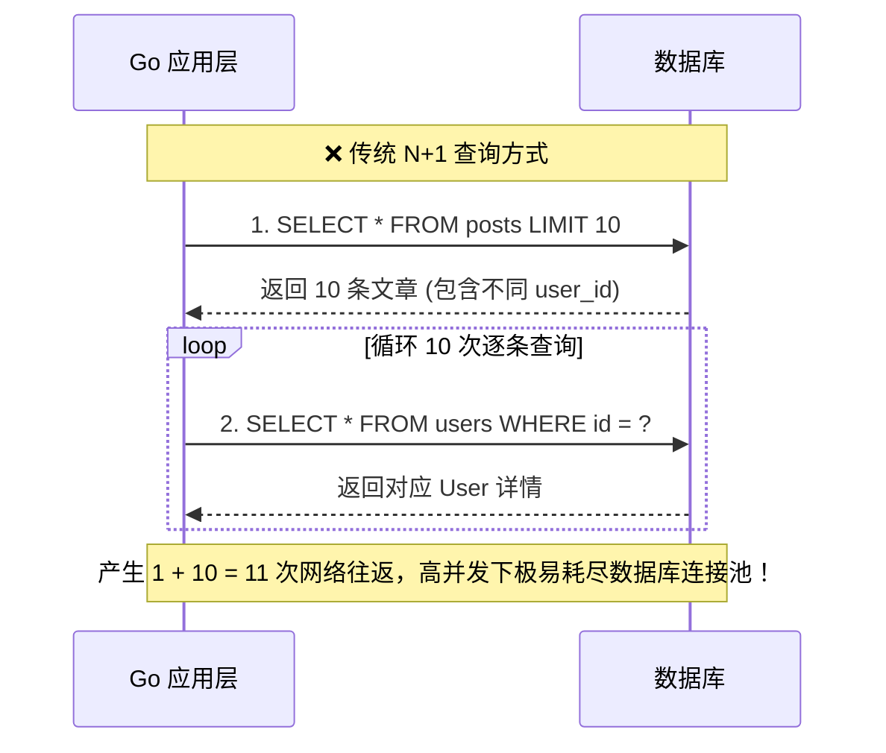
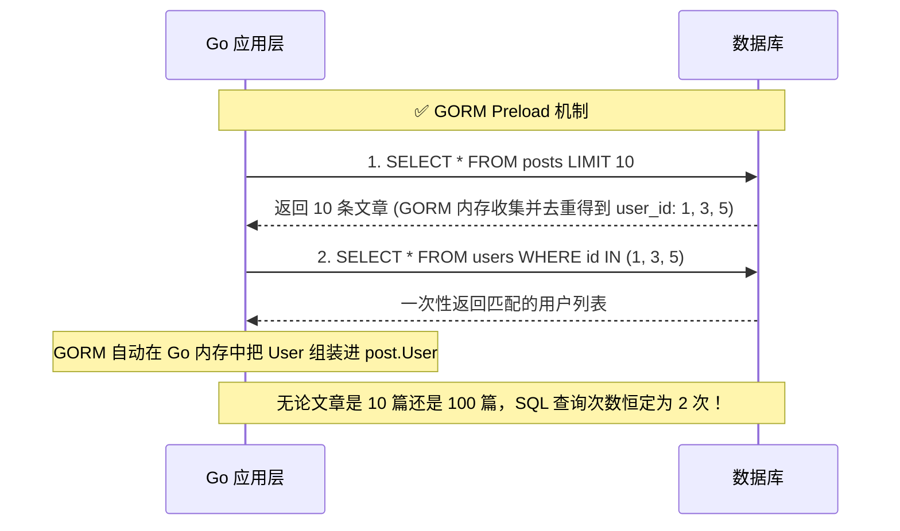

# GORM Preload 与 N+1 查询深度解析 (学习笔记)

> **背景**：Gin 博客系统综合项目（Homework 4 & Cyber-Blog）进阶复盘，深度整理关系型数据库 ORM 预加载机制与关联查询优化。  
> **时间**：2026-10  
> **关联源码**：[`05_Practical_Training/blog/handlers/post.go`](file:///Users/wangtong/workspace/web3-lab/05_Practical_Training/blog/handlers/post.go)

---

## 1. 什么是 N+1 查询问题？

在面向对象（Go Struct）与关系型数据库（Relational Tables）交互时，表之间通过外键建立联系。  
例如：`posts`（文章表）只存储了 `user_id`，而前端页面需要展示文章标题及其作者的名字 `username`。

### 1.1 业务场景
用户访问博客首页，系统需要列出最新的 **10 篇文章**以及每篇文章的**作者信息**。

### 1.2 传统循环查询代码（新手陷阱）
很多初学者会写出类似下面的代码：
```go
// 1. 查出 10 篇文章（执行 1 次查询）
var posts []Post
db.Limit(10).Find(&posts)

// 2. 遍历这 10 篇文章，每拿出一篇，就再去查一次用户表（循环执行 N 次查询）
for i := range posts {
    var user User
    db.Where("id = ?", posts[i].UserID).First(&user) // 循环查库！
    posts[i].User = user
}
```

### 1.3 底层产生的 SQL 与性能危害
1. **主表查询（1 次）**：
   ```sql
   SELECT * FROM posts LIMIT 10;
   ```
2. **子表查询（N 次，此处 N=10）**：
   ```sql
   SELECT * FROM users WHERE id = 1;
   SELECT * FROM users WHERE id = 2;
   SELECT * FROM users WHERE id = 3;
   ...
   SELECT * FROM users WHERE id = 10;
   ```
3. **总查询次数 = 1 + N = 11 次**。  
   如果页面分页是每页 50 条，就会发起 **1 + 50 = 51 次**独立的数据库网络往返（RTT, Round Trip Time）。



---

## 2. GORM 的 `Preload` 机制与底层原理

GORM 提供了 `Preload`（预加载，属于 Eager Loading 贪婪加载）：

```go
// ✅ 优雅的高性能写法：
var posts []Post
db.Preload("User").Preload("Category").Limit(10).Find(&posts)
```

### 2.1 底层执行的两步法 SQL
GORM **并不是**傻乎乎地去循环查库，而是自动执行批量收集：

1. **第 1 条 SQL（查主表）**：
   ```sql
   SELECT * FROM `posts` LIMIT 10;
   ```
2. **内存收集与去重**：  
   GORM 遍历这 10 篇返回的文章，在内存中提取所有的 `user_id` 并自动去重，得到集合（例如 `[1, 3, 5]`）。
3. **第 2 条 SQL（批量查关联表）**：  
   使用 `IN` 关键字一次性批量将所有相关作者拉回：
   ```sql
   SELECT * FROM `users` WHERE `id` IN (1, 3, 5);
   ```
4. **Go 内存自动绑定**：  
   GORM 在 Go 进程内存中建立索引哈希映射，依据外键把每个 `User` 对象指针挂载到对应文章的 `post.User` 上。



> **核心结论**：不论展示 10 篇、50 篇还是 100 篇文章，SQL 查询次数**恒定只有 2 次**！

---

## 3. 为什么不用 JOIN？Preload vs JOIN 的权衡

很多开发者会问：“为什么不直接用一条 `LEFT JOIN` 把所有字段一次查出来？”

| 对比维度 | GORM `Preload` (双查询模式) | SQL `LEFT JOIN` (单查询模式) |
| :--- | :--- | :--- |
| **查询次数** | 固定 2 次（1 次主表 + 1 次 `IN (?)`） | 1 次（单条复合 SQL） |
| **数据冗余传输** | **极低**。主表和子表数据各传输 1 次，无重复数据 | **可能极高**。在一对多关系下（如文章关联评论），每多一条评论，文章的标题和长文本就会在网络中重复传输 1 次 |
| **笛卡尔积风险** | **无**。两个查询相互独立，内存拼装 | 关联多张一对多表时极易产生**笛卡尔积膨胀**，拖垮数据库内存与网络 |
| **数据模型映射** | 映射到复杂嵌套 Struct 非常清晰自然 | 映射到嵌套结构体时 ORM 需要做复杂的去重折叠解析 |
| **最佳适用场景** | 一对多、多对多、Web API 列表与详情展示 | 仅仅检索单条记录、或需要**依据子表字段进行主表排序/筛选**（例如：筛选出“作者等级 > 5 的所有文章”） |

---

## 4. GORM Preload 核心实战技巧

### 4.1 嵌套预加载 (Nested Preload)
查询文章时，不仅需要作者，还需要作者的个人资料卡（Profile）：
```go
db.Preload("User.Profile").Find(&posts)
```

### 4.2 带条件的预加载 (Preload with Conditions)
只想预加载“已审核通过”的评论：
```go
db.Preload("Comments", "status = ?", "approved").Find(&posts)
```

### 4.3 自定义预加载排序与分页
如果只想预加载文章最新的 5 条评论：
```go
db.Preload("Comments", func(db *gorm.DB) *gorm.DB {
    return db.Order("comments.created_at DESC").Limit(5)
}).Find(&posts)
```

---

## 5. 核心速查与面试必答题

* **Q：什么是 N+1 查询问题？危害是什么？**  
  * **答**：当应用程序在查询主表数据后，通过循环方式逐条去查询每条记录的外键关联子表，就会执行 1 次主表查询加 N 次子表查询（共 1+N 次）。其主要危害是导致应用与数据库之间的网络往返（RTT）次数呈线性激增，极易耗尽数据库连接池，造成接口延迟居高不下。
* **Q：GORM 的 `Preload` 解决 N+1 的底层机制是怎样的？**  
  * **答**：GORM 采用 `IN (?)` 双查询策略。首先查出主表数据，并在 Go 内存中收集所有外键 ID 进行去重；随后发起第 2 条 SQL：`SELECT * FROM sub_table WHERE id IN (...)` 一次性拉回所有匹配的子记录；最后由 GORM 在内存中根据外键完成对象关系的绑定组装。
* **Q：什么情况下适合用 `JOIN`，什么情况下适合用 `Preload`？**  
  * **答**：如果需要根据关联表的字段对主表进行过滤或排序（例如 `WHERE users.status = 'active'`），必须使用 `JOIN`；而在大多数单纯的关联数据获取展示场景（特别是一对多关系）下，推荐使用 `Preload`，以避免数据网络重复传输与笛卡尔积膨胀。
