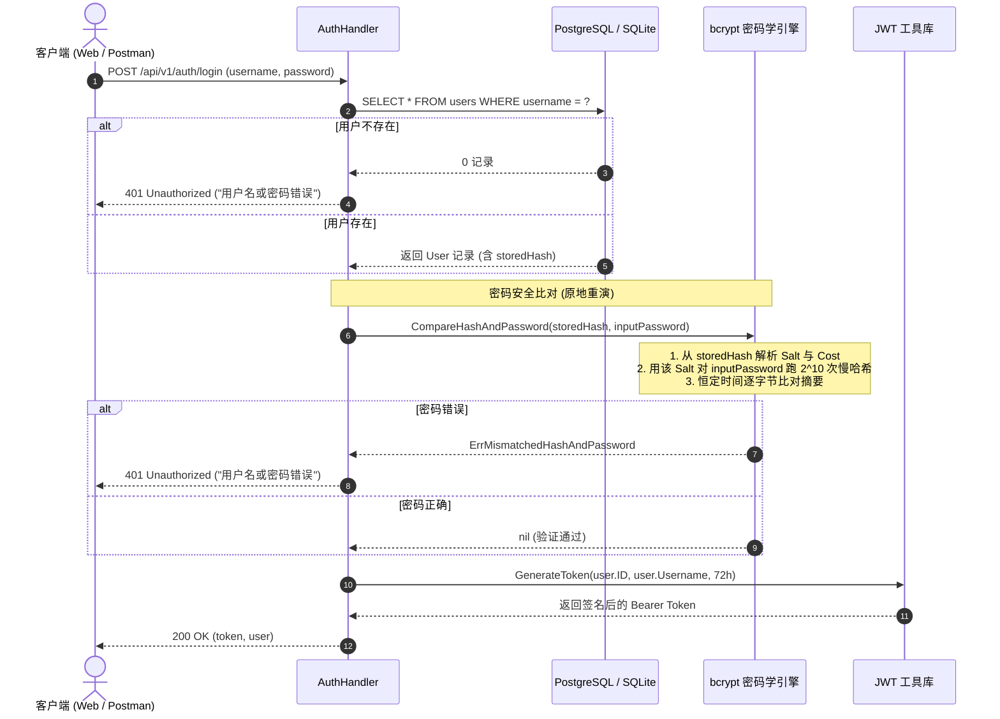

# GORM Preload (N+1查询) 与 Bcrypt 密码安全 学习笔记 (Homework 4 / Cyber-Blog)

> **背景**：Gin 博客系统（User / Post / Comment / Taxonomy）进阶复盘，深度整理 ORM 预加载与密码学单向散列的底层原理。  
> **时间**：2026-10  
> **关联源码**：[`05_Practical_Training/blog/handlers/post.go`](file:///Users/wangtong/workspace/web3-lab/05_Practical_Training/blog/handlers/post.go) & [`pkg/utils/password.go`](file:///Users/wangtong/workspace/web3-lab/05_Practical_Training/blog/pkg/utils/password.go)

---

## 目录
- [主题一：GORM Preload 与 N+1 查询问题](#主题一gorm-preload-与-n1-查询问题)
  - [1.1 什么是 N+1 查询问题？](#11-什么是-n1-查询问题)
  - [1.2 传统查询 vs Preload 底层 SQL 对比](#12-传统查询-vs-preload-底层-sql-对比)
  - [1.3 为什么不用 JOIN？Preload vs JOIN 的权衡](#13-为什么不用-joinpreload-vs-join-的权衡)
  - [1.4 GORM Preload 核心实战用法](#14-gorm-preload-核心实战用法)
  - [1.5 主题一速查与面试答题要点](#15-主题一速查与面试答题要点)
- [主题二：密码学哈希与 bcrypt 工作原理](#主题二密码学哈希与-bcrypt-工作原理)
  - [2.1 密码存储演变史：为什么 MD5 / SHA-256 全军覆没？](#21-密码存储演变史为什么-md5--sha-256-全军覆没)
  - [2.2 bcrypt 慢哈希的降维打击机制](#22-bcrypt-慢哈希的降维打击机制)
  - [2.3 剖析 bcrypt 密文字符串结构](#23-剖析-bcrypt-密文字符串结构)
  - [2.4 验证端的「原地重演」流程](#24-验证端的原地重演流程)
  - [2.5 恒定时间比对（Constant-Time Comparison）防计时攻击](#25-恒定时间比对constant-time-comparison防计时攻击)
  - [2.6 登录验证完整时序图](#26-登录验证完整时序图)
  - [2.7 主题二速查与面试答题要点](#27-主题二速查与面试答题要点)

---

# 主题一：GORM Preload 与 N+1 查询问题

## 1.1 什么是 N+1 查询问题？

在面向对象（Go Struct）与关系型数据库（Relational Tables）交互时，表之间通过外键关联。  
例如：`posts`（文章表）只存储了 `user_id`，而文章需要展示作者的名字 `username`。

* **典型业务场景**：用户访问博客首页，系统需要列出最新的 **10 篇文章**及其**作者信息**。
* **新手常见写法（循环查询 / 懒加载陷阱）**：
  ```go
  // 1. 查出 10 篇文章（执行 1 次查询）
  var posts []Post
  db.Limit(10).Find(&posts)

  // 2. 遍历这 10 篇文章，每拿出一篇就再去查一次用户表（循环执行 N 次查询）
  for i := range posts {
      var user User
      db.Where("id = ?", posts[i].UserID).First(&user)
      posts[i].User = user
  }
  ```
* **产生的 SQL 查询次数**：
  1. 查文章列表：`SELECT * FROM posts LIMIT 10;` （**1 次**）
  2. 查各文章作者：`SELECT * FROM users WHERE id = ?;` （**N 次**，N=10）
  3. **总 SQL 次数 = 1 + N = 11 次**。若页面分页每页 50 条，就会发起 **51 次**数据库网络往返（Round Trip Time, RTT），极易占满数据库连接池并导致响应延迟暴增。

---

## 1.2 传统查询 vs Preload 底层 SQL 对比

GORM 提供了 `Preload`（预加载，属于 Eager Loading 贪婪加载）：

```go
// 优雅的高性能写法：
var posts []Post
db.Preload("User").Preload("Category").Limit(10).Find(&posts)
```

### 底层实际执行的 SQL：
1. **第 1 条 SQL**：查文章列表
   ```sql
   SELECT * FROM `posts` LIMIT 10;
   ```
2. **GORM 内存处理**：
   从返回的 10 条文章中，收集所有的 `user_id` 并**自动去重**，例如得到 `[1, 3, 5]`。
3. **第 2 条 SQL**：使用 `IN` 一次性批量拉回所有作者
   ```sql
   SELECT * FROM `users` WHERE `id` IN (1, 3, 5);
   ```
4. **内存自动组装**：
   GORM 在 Go 进程内存中，根据 `user_id` 自动将每个 `User` 结构体指针绑定到对应 `Post.User` 字段上。

> **结论**：无论文章有 10 篇、50 篇还是 100 篇，**SQL 查询次数永远稳定在 2 次**！

---

## 1.3 为什么不用 JOIN？Preload vs JOIN 的权衡

| 对比维度 | GORM `Preload` (双查询法) | SQL `LEFT JOIN` (单查询法) |
| :--- | :--- | :--- |
| **查询次数** | 固定 2 次（主表 1 次 + `WHERE id IN (...)` 1 次） | 1 次（单条联合 SQL） |
| **网络数据量** | **极小**，每个用户数据只在网络中传输 1 次 | **可能急剧膨胀**（尤其是一对多关系，如文章关联评论，文章内容会重复传输多次） |
| **笛卡尔积风险**| **无风险**，主从表完全解耦查出并在内存映射 | 关联多张表时可能引发笛卡尔积，导致数据库临时表暴增 |
| **适用场景** | 一对一、一对多、多对多的大多数 Web 业务场景 | 仅单条记录检索、基于关联表字段过滤排序（如按作者等级排序文章） |

---

## 1.4 GORM Preload 核心实战用法

### 1.4.1 嵌套预加载 (Nested Preload)
查询文章时，不仅需要作者，还需要作者的个人资料卡：
```go
db.Preload("User.Profile").Find(&posts)
```

### 1.4.2 带条件的预加载 (Preload with Conditions)
只想预加载已审核通过的评论：
```go
db.Preload("Comments", "status = ?", "approved").Find(&posts)
```

### 1.4.3 自定义预加载查询规则
对预加载的关联项进行排序或截断：
```go
db.Preload("Comments", func(db *gorm.DB) *gorm.DB {
    return db.Order("comments.created_at DESC").Limit(5)
}).Find(&posts)
```

---

## 1.5 主题一速查与面试答题要点

* **Q：什么是 N+1 查询？**
  * **答**：在通过 ORM 查询主表数据时，如果采用循环遍历的方式逐条查询其关联的外键子表，就会导致执行 1 次主表查询和 N 次子表查询（共 1+N 次网络交互），这就是 N+1 查询问题。
* **Q：GORM 是如何解决 N+1 问题的？**
  * **答**：GORM 提供了 `Preload` 机制，先查出主表数据，并在内存中收集所有外键 ID 进行去重，随后生成一条 `WHERE id IN (...)` 批量查询子表，最后在内存中自动组装对象。查询次数从 1+N 缩减为恒定的 2 次。

---

# 主题二：密码学哈希与 bcrypt 工作原理

## 2.1 密码存储演变史：为什么 MD5 / SHA-256 全军覆没？

```
第1代：明文存储       ❌ 数据库被拖库即全军覆没
       ⬇
第2代：普通哈希(MD5)   ❌ 彩虹表字典秒级反查（固定明文对应固定哈希）
       ⬇
第3代：简单加盐哈希   ❌ 抵挡不了现代 GPU 算力暴力枚举（MD5/SHA 速度太快，单卡每秒算百亿次）
       ⬇
第4代：慢哈希(bcrypt)  ✅ 自带随机 Salt + 指数级计算轮次（故意变慢），让暴力破解算力成本呈天文数字
```

### 传统哈希的致命缺陷：
1. **彩虹表反查 (Rainbow Table)**：
   `md5("123456") = e10adc3949ba59abbe56e057f20f883e` 是固定映射。攻击者预先计算数十亿常用口令的哈希并建库，拿到密文就能瞬间反查明文。
2. **高速算法缺陷**：
   MD5 和 SHA-256 是为**文件传输完整性校验**设计的，目标是“越快越好”。但在密码学中，“太快”等同于“方便黑客暴力破解”。在消费级显卡（如 RTX 4090）上，一秒能计算上百亿次哈希。

---

## 2.2 bcrypt 慢哈希的降维打击机制

`bcrypt` 是专门为密码存储而发明的**自适应慢哈希算法（Slow Hash Algorithm）**。

1. **内置动态随机 Salt**：
   每次调用 `bcrypt.GenerateFromPassword`，内部都会利用高安全性熵源生成一个 **128 位随机 Salt**。
   * **现象**：哪怕同一个用户用完全相同的密码 `"password123"` 连续加密 3 次，输出的密文字符串也截然不同！通用彩虹表彻底失效。
2. **可控工作因子（Cost / Work Factor）**：
   `bcrypt` 的计算复杂度为 **$2^{\text{cost}}$ 轮** 密钥扩展循环。
   * 项目中使用 `Cost = 10`，意味着执行 $2^{10} = 1024$ 轮密集加密迭代。
   * **对正常用户**：CPU 耗时约 50ms~80ms，用户点击登录毫无感知。
   * **对攻击者**：暴力枚举速度从一秒上百亿次骤降到一秒十几次，破解一个中等复杂度密码需要数百年。

---

## 2.3 剖析 bcrypt 密文字符串结构

在数据库 `users` 表的 `password` 字段中，存入的字符串长达 60 字节，其内部结构为**自包含（Self-contained）**设计：

```text
$2a$10$vI8aWBnW3fID.ZQ4/zo1G.q1lRps.9cGLcZEiGDMVr5yUP1KUOYTa
├───┼──┼──────────────────────┼─────────────────────────────┤
 版本 Cost    22字符随机 Salt             31字符密码密文
```

| 字段片段 | 字符示例 | 含义解释 |
| :--- | :--- | :--- |
| **算法版本** | `$2a$` | 表示采用 bcrypt 规范的 2a 版本 |
| **计算轮次** | `$10$` | 表示工作因子 Cost 为 10（即计算 $2^{10} = 1024$ 轮） |
| **内嵌 Salt** | `vI8aWBnW3fID.ZQ4/zo1G.` | 生成时随机创建的 128 位 Salt（Base64 编码为 22 字符） |
| **哈希摘要** | `q1lRps.9cGLcZEiGDMVr5yUP1KUOYTa` | 密码经上述 Salt 和轮次迭代后的最终密文（31 字符） |

> **关键认知**：数据库无需专门建立 `salt` 字段和 `cost` 字段，因为它们已经自包含在密文的前半部分中！

---

## 2.4 验证端的「原地重演」流程

由于哈希是严格**单向不可逆**的，系统在验证时**绝不可能“解密”密文**。  
那么它如何验证登录密码是否正确？

$$ \text{Result} = \text{bcrypt}(\text{口令}, \text{Salt}, \text{Cost}) $$

1. **提取参数**：
   验证函数 `bcrypt.CompareHashAndPassword(storedHash, inputPassword)` 首先从数据库取出的 `storedHash` 头部，直接解析出当初注册时用的 **Cost（10）** 与 **Salt**。
2. **原地重演**：
   拿着这个提取出的 Salt 和 Cost，以及用户在登录表单提交的明文 `inputPassword`，在验证服务器本地完整重算一遍哈希。
3. **比对结果**：
   比较新计算出来的哈希摘要与数据库保存的摘要是否完全相等。若相等，证明密码正确！

---

## 2.5 恒定时间比对（Constant-Time Comparison）防计时攻击

在底层源码中，密码比对不使用传统的 `string1 == string2` 短路比对，而是使用**时间恒定算法**：

* **传统短路比对缺陷**：如果第 1 个字符不同就直接返回 `false`。这意味着猜对 5 个字符比猜对 0 个字符耗时多几个纳秒。攻击者使用高精度探针测量网络耗时差，就能逐位套出密码（**计时攻击 / Timing Attack**）。
* **恒定时间比对**：无论在第几个字节出现差异，算法都强制完整遍历完所有的字节并累加异或结果，耗时完全恒定，从根源杜绝纳秒级侧信道泄露。

---

## 2.6 登录验证完整时序图



---

## 2.7 主题二速查与面试答题要点

* **Q：为什么密码不能用 MD5 或 SHA-256 存储？**
  * **答**：MD5/SHA 算法速度过快，现代 GPU 每秒可算数十亿次，易被暴力破解；且缺少动态盐时容易被预先计算好的彩虹表反查。
* **Q：bcrypt 是如何做到每次加密密文都不一样，却还能验证密码的？**
  * **答**：bcrypt 在加密时会自动生成一个 128 位的随机 Salt，并将算法版本、Cost 轮次与该 Salt 一并编码在最终生成的 60 字节密文字符串头部。验证时，系统提取出该 Salt 和 Cost，对输入的明文重新运行一遍慢哈希计算，再通过恒定时间比对两个密文摘要是否一致。
* **Q：什么是计时攻击（Timing Attack），bcrypt 如何防范？**
  * **答**：计时攻击是攻击者利用字符串普通逐字比较时的短路耗时差异，推断匹配前缀字符的技术。bcrypt 内部采用了恒定时间比对（Constant-Time Comparison），无论是否匹配都比完全部字节，使执行时间保持恒定，消除时间侧信道漏洞。
